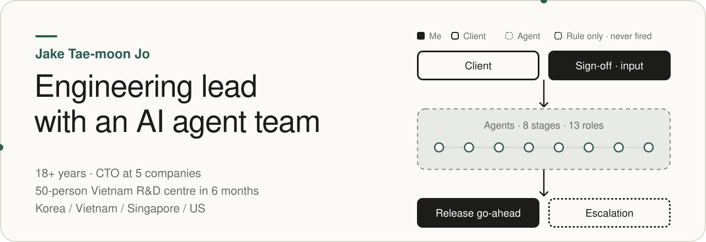
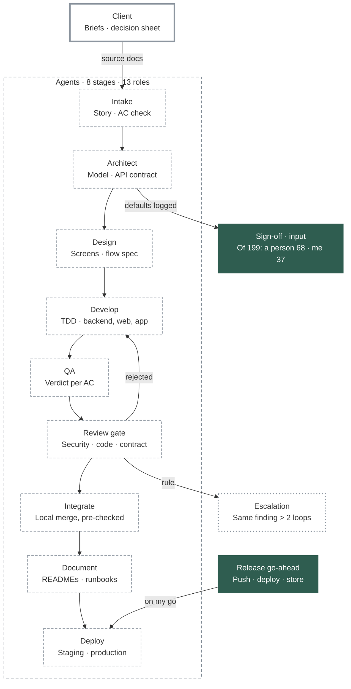
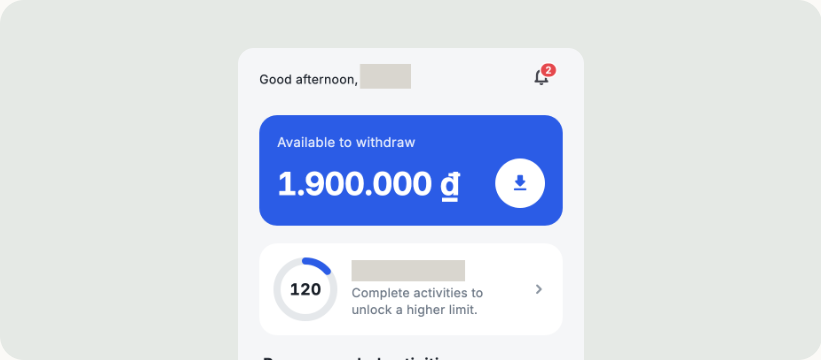
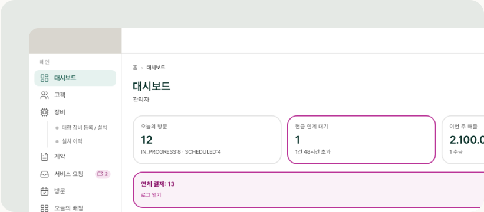
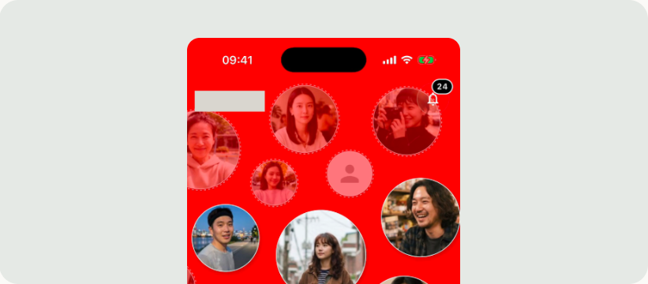
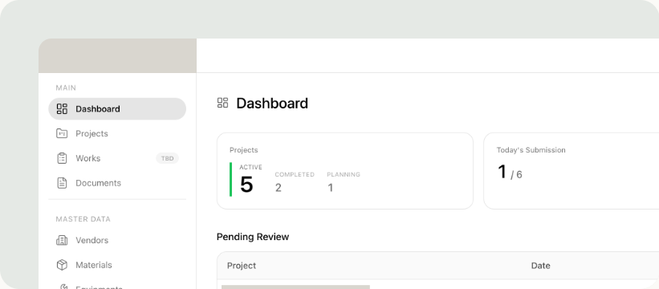
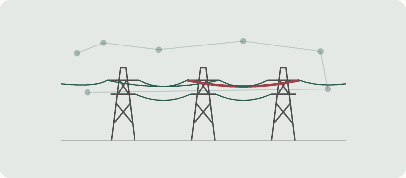

<a href="https://jake-jo-portfolio.vercel.app/en/"><picture><source media="(prefers-color-scheme: dark)" srcset="assets/banner-dark.svg"></picture></a>

I design and run a role-based AI agent team. The agents do design, implementation, testing and review; I set the roles and the gates (the checks work must pass before it moves on). Irreversible or outward-facing actions, such as deploys and pushes, run on my instruction; design decisions go ahead on the agents' recommendation and are reviewed from the decision record. When a project needs it, I do the product planning too. In 2026 I ran client projects this way, and every change request from the client was shipped within 24 hours. One of them, a fintech platform, went from scratch to the production data migration in five months.

> [!NOTE]
> Most of my work lives in private client repositories: 239 public vs 3,493 private contributions in the past year (as of Nov 2026). Client projects below are anonymized.

## Now

I define an 8-stage pipeline and assign design, implementation, QA and review to the agent team's 13 roles. So that work never stalls, decisions go ahead on a recommended default, are logged, and are reviewed later. Over five months the team built a fintech platform (mobile app, operator CMS, partner portals) and moved the old v1's data onto the production server.

One feature, from spec to production: the full pipeline

## Selected work

All 6: only human on the build team; designed and ran the AI agent team.

<table>
<tr>
<td width="50%" valign="top">
<a href="https://jake-jo-portfolio.vercel.app/en/work/ewa/"><picture><source media="(prefers-color-scheme: dark)" srcset="assets/work-ewa-dark.png"></picture></a>

<b><a href="https://jake-jo-portfolio.vercel.app/en/work/ewa/">Earned Wage Access fintech platform, Vietnam</a></b> Jun 2026 – present · Data migrated

Built the employee app, the operator CMS and the employer and partner portals from scratch over five months, then moved the running v1's data onto the v2 production server.

<a href="https://jake-jo-portfolio.vercel.app/en/work/ewa/">Case study</a> · <a href="https://jake-jo-portfolio.vercel.app/ko/work/ewa/">한국어</a> · <a href="https://jake-jo-portfolio.vercel.app/pdf/jake-jo-ewa-en.pdf">PDF</a>

</td>
<td width="50%" valign="top">
<a href="https://jake-jo-portfolio.vercel.app/en/work/field-service-ops/"><picture><source media="(prefers-color-scheme: dark)" srcset="assets/work-field-service-ops-dark.png"></picture></a>

<b><a href="https://jake-jo-portfolio.vercel.app/en/work/field-service-ops/">Operations system for home-appliance sales, rental and maintenance</a></b> May – Nov 2026 · 3 areas in live use

Built an office web app, a technician app and a customer portal; real use began 123 days after the first commit, and 26 days later the data from the client's old management program was moved into production.

<a href="https://jake-jo-portfolio.vercel.app/en/work/field-service-ops/">Case study</a> · <a href="https://jake-jo-portfolio.vercel.app/ko/work/field-service-ops/">한국어</a> · <a href="https://jake-jo-portfolio.vercel.app/pdf/jake-jo-field-service-ops-en.pdf">PDF</a>

</td>
</tr>
<tr>
<td width="50%" valign="top">
<a href="https://jake-jo-portfolio.vercel.app/en/work/reputation-market/"><picture><source media="(prefers-color-scheme: dark)" srcset="assets/work-reputation-market-dark.png"></picture></a>

<b><a href="https://jake-jo-portfolio.vercel.app/en/work/reputation-market/">Reputation-based trading platform</a></b> Oct 2026 (20 days) · Pre-launch

Built a user app, an admin tool and an API server from scratch, with the admin tool in place 13 days after the first commit; the features went in as eight bundles, each built and checked before its commit (20 days, pre-launch), and 238 of 242 planning answers went into the spec.

<a href="https://jake-jo-portfolio.vercel.app/en/work/reputation-market/">Case study</a> · <a href="https://jake-jo-portfolio.vercel.app/ko/work/reputation-market/">한국어</a> · <a href="https://jake-jo-portfolio.vercel.app/pdf/jake-jo-reputation-market-en.pdf">PDF</a>

</td>
<td width="50%" valign="top">
<a href="https://jake-jo-portfolio.vercel.app/en/work/construction-pmis/"><picture><source media="(prefers-color-scheme: dark)" srcset="assets/work-construction-pmis-dark.png"></picture></a>

<b><a href="https://jake-jo-portfolio.vercel.app/en/work/construction-pmis/">Daily site reports and project management for a construction company</a></b> Apr – Jul 2026 · Client UAT

Started from a general construction project management system (PMIS), rebuilt it around the client's paper daily reports, cut finance features already built, and took it to client acceptance testing (UAT).

<a href="https://jake-jo-portfolio.vercel.app/en/work/construction-pmis/">Case study</a> · <a href="https://jake-jo-portfolio.vercel.app/ko/work/construction-pmis/">한국어</a> · <a href="https://jake-jo-portfolio.vercel.app/pdf/jake-jo-construction-pmis-en.pdf">PDF</a>

</td>
</tr>
<tr>
<td width="50%" valign="top">
<a href="https://jake-jo-portfolio.vercel.app/en/work/screenplay-translation/"><picture><source media="(prefers-color-scheme: dark)" srcset="assets/work-screenplay-translation-dark.png"></picture></a>

<b><a href="https://jake-jo-portfolio.vercel.app/en/work/screenplay-translation/">A translation pipeline for feature-film screenplays</a></b> Sep – Oct 2026 · 4 films, 5 full runs

Designed a screenplay-translation pipeline in which 11 AI agent roles translate and judge, and translated four feature scripts end to end five times in two directions.

<a href="https://jake-jo-portfolio.vercel.app/en/work/screenplay-translation/">Case study</a> · <a href="https://jake-jo-portfolio.vercel.app/ko/work/screenplay-translation/">한국어</a> · <a href="https://jake-jo-portfolio.vercel.app/pdf/jake-jo-screenplay-translation-en.pdf">PDF</a>

</td>
<td width="50%" valign="top">
<a href="https://jake-jo-portfolio.vercel.app/en/work/grid-constraint-analysis/"><picture><source media="(prefers-color-scheme: dark)" srcset="assets/work-grid-constraint-analysis-dark.png"></picture></a>

<b><a href="https://jake-jo-portfolio.vercel.app/en/work/grid-constraint-analysis/">Wholesale power-price analysis pipeline, North America</a></b> Aug – Sep 2026 · 6 hypotheses adopted

Built a pipeline that writes transmission-constraint memos, refined it through 22 hypothesis experiments, and rolled back an adopted one on finding the scoring code was not the code that writes the memos.

<a href="https://jake-jo-portfolio.vercel.app/en/work/grid-constraint-analysis/">Case study</a> · <a href="https://jake-jo-portfolio.vercel.app/ko/work/grid-constraint-analysis/">한국어</a> · <a href="https://jake-jo-portfolio.vercel.app/pdf/jake-jo-grid-constraint-analysis-en.pdf">PDF</a>

</td>
</tr>
</table>

## Stack

This README, the site and its PDFs are built from one typed content source: [portfolio-site](https://github.com/JoJakeTaemoon/portfolio-site).

## Experience

- **Founder · Lead Engineer** · LogicaJ (Korea) · 2026 – present
- **General Director** · XT Solution (Vietnam) · 2025 – 2026
- **Director of Business** · Papa Mobility (Korea) · 2024 – 2025
- **CTO → CSO** · Daoukiwoom Innovation (Vietnam · Singapore) · 2021 – 2024

## How I lead

- Built organisations from zero: a Vietnam R&D centre of 50 people in 6 months, and, as a co-founding CTO, a development team that shipped an MVP in 6 months and a 12-person product team. More recently, from 2024, I managed a 30-person development team directly.
- Split the roles and put gates in place: when setting up a company I defined finance, HR and engineering operations and the development methodology first, and built hiring assignments as real codebases with tests already in them (45 submissions in 2025). The agent team was split into 13 roles (9 plus 4 reviewers), and three of the reviewers sit in the pipeline's review stage.
- Record decisions with their reasons: the agent team went ahead on recommended defaults so work never stalled; 192 of the 199 decisions record how hard they are to reverse, and those that reverse an earlier decision name the one they reverse.
- Kept coding under leader titles: EVM smart contracts as a CTO, iPhone apps and back ends as a co-founding CTO.

한국어 소개

AI 에이전트 팀으로 제품을 만드는 개발 리드

역할별 AI 에이전트 팀을 설계해 운영합니다. 설계·구현·테스트·리뷰는 에이전트가 맡고, 저는 역할과 게이트(다음 단계로 넘기기 전에 통과해야 하는 검사)를 정합니다. 배포·푸시처럼 되돌릴 수 없거나 밖으로 나가는 행동은 제 지시로 실행하고, 설계 결정은 에이전트 추천안으로 진행한 뒤 결정 기록으로 검토합니다. 필요하면 기획까지 맡습니다. 2026년에 이 방식으로 고객사 프로젝트를 진행했고, 고객의 수정 요청은 모두 24시간 안에 반영했습니다. 핀테크 플랫폼은 5개월 동안 처음부터 만들어 운영 데이터 이전까지 마쳤습니다.

[한국어 포트폴리오](https://jake-jo-portfolio.vercel.app/ko/)

## Contact

- Email: whxoans@gmail.com
- Phone: +82 10-9233-7440
